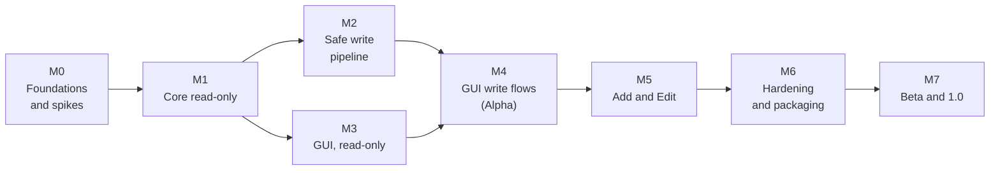

# Roadmap: Claw

> **Stack: Swift 6 + SwiftUI, app name Claw** ([ADR-0001](adr/0001-stack-swift-swiftui.md), [ADR-0002](adr/0002-name-claw.md)). Updated 2026-11-04. TypeScript blocks in `TECHNICAL-DESIGN.md` are kept as the behaviour spec; the Swift code in `Sources/ClawCore` implements them.


Version 0.1 · 2026-11-04 · Status: draft
Companion files: [`OVERVIEW.md`](OVERVIEW.md) · [`PRD.md`](PRD.md) · [`TECHNICAL-DESIGN.md`](TECHNICAL-DESIGN.md)
Tags: **[V]** verified · **[A]** assumption · **[U]** unknown (spike `S*`).

Effort figures are **estimates [A]** for one full-time engineer. No benchmark was used; re-estimate at the end of M0 when the spikes are closed.

---

## 1. Plan on a page

| Milestone | Goal | Features | Effort | Ends with |
| :- | :- | :- | :- | :- |
| **M0** Foundations and spikes | Repo, decisions, unknowns closed | none (setup) | ~1 wk | ADRs accepted, all spikes answered |
| **M1** Core read-only | Scan and classify everything, from a CLI | F02, F14, data for F03, F04 | ~3 wks | `claw scan --json` matches Claude Code's own views |
| **M2** Safe write pipeline | Change things safely and undo them, from a CLI | F07, F08, F11 core, F12 core, F15 | ~3 wks | Apply, rollback, restore proven by tests |
| **M3** GUI shell, read-only | The prototype running on real data | F01, F03, F04, F05 view, F06 view, F13 view | ~3 wks | Every view shows real scan data |
| **M4** GUI write flows | Queue, review, apply, history, restore in the UI | F05, F07, F08, F11, F12, F13, F17 | ~2 wks | **Alpha: all P0 features** |
| **M5** Add and Edit | Add every concept; open sources in your editor | F09, F10, F16 | ~3 wks | All P1 features |
| **M6** Hardening and packaging | Security review, signing, notarisation, accessibility, i18n | NFR-SEC, NFR-DIST, NFR-A11Y, NFR-I18N | ~2 wks | Notarised DMG |
| **M7** Beta and 1.0 | Dogfood on real projects, fix, release | all | ~2 wks | **1.0** |

Total about 19 weeks [A]. M2 and M3 can overlap (M3 needs only M1's data). With one person, do them in order.



Why this order: the CLI-first path (M1, M2) puts the dangerous part, writing your config files, under tests **before** any GUI can trigger it. The GUI then cannot do anything the tested core does not allow.

## 2. Working agreements (all milestones)

These follow your standing rules.

- **Branches and commits:** never work on the default branch; one branch per milestone or task; small focused commits in the repo's style; commit or push only when you ask.
- **Definition of done for every task:** typecheck, lint and the tests closest to the change pass; the full suite and build pass when the change is shared; docs, example config and contracts updated in the same change.
- **Bug fixes:** write the failing test first, then fix the root cause. Never weaken a test to pass.
- **Verification before claiming:** report each check as passed, failed, skipped, blocked or not run. Local success on one Mac does not prove other macOS or Claude Code versions.
- **Secrets:** none in code, logs, fixtures, examples or commits. Fixtures use fake values.
- **Environments:** tests run against fixtures or a temporary config directory, **never against your real `~/.claude`** unless a task says "dogfood".
- **Risky changes:** state the rollback path in the PR description.
- **Decisions needing you:** adding a dependency, changing a public contract, touching signing credentials, anything that writes outside the repo.

## 3. Milestones in detail

### M0 Foundations and spikes (~1 week)

**Goal:** a repo you can build in, decisions written down, every **[U]** in the P0 tables answered or given a workaround.
**Implements:** none. Closes `S1` to `S10`, `OQ-1`, `OQ-4`, `OQ-5`, `OQ-6`, `OQ-8`.

| # | Task | Done when |
| :- | :- | :- |
| M0.1 | Ask me the repo name, then on your Mac: `git init /Users/mac/Documents/GitHub/<repo-name>`; if the folder exists, do not overwrite it (check `git remote -v` and `git status`). This cloud session cannot do it because that path does not exist here | Repo exists; default branch protected by habit, work on a branch |
| M0.2 | Record the environment in `docs/environment.md`: macOS version, Xcode, `swift --version`, `claude --version`. No paths with secrets | File committed |
| M0.3 | Copy `OVERVIEW.md`, `PRD.md`, `TECHNICAL-DESIGN.md`, `ROADMAP.md` into `docs/`; create `CLAUDE.md` from Appendix B | Committed |
| M0.4 | Swift package skeleton: `ClawCore`, `claw`, `ClawApp` (macOS only), `ClawCoreTests`; Swift 6 language mode; `swift format` config; CI with a Linux and a macOS job | CI green on the skeleton |
| M0.5 | Write ADRs in `docs/adr/`: stack (OQ-1), no fork, distribution (OQ-6), enable/disable policy (TD 9.8), minimum Claude Code and macOS (OQ-4, OQ-5), name (OQ-8) | Each ADR has context, decision, consequences |
| M0.6 | Run spikes `S1` to `S10` per `TECHNICAL-DESIGN.md` section 15, each in a **temporary config directory**, not your real one. Write `docs/spikes.md` with the commands, the redacted output and the conclusion | Every spike has a status: verified, workaround, or deferred with a reason |
| M0.7 | Pin tool versions: Swift toolchain, Xcode, CI images and runners; record them in `docs/environment.md` | Versions listed |
| M0.8 | Update the `[U]` tags in the three docs from the spike results; add a "Verified on `<claude --version>`" line | Docs consistent |

**Exit criteria:** ADRs accepted; spike report complete; `PRD.md` tables have no **[U]** left for P0 features (or the row says "not supported in 1.0"); CI green.
**Risks:** R9 (a verified-looking key behaves differently), R7.

### M1 Core read-only: scan and classify (~3 weeks)

**Goal:** `claw scan` reads all seven concepts for This Mac or one folder, classifies every item, and writes nothing.
**Implements:** F02, F14, the data side of F03 and F04. `FR-F02-*`, `FR-F14-*`, `NFR-COMPAT-2`, `NFR-PERF-1`.
**Design:** `TECHNICAL-DESIGN.md` sections 3, 5, 6, 7, 8.

| # | Task | Done when |
| :- | :- | :- |
| M1.1 | Model types (`Model.swift`, `Item.swift`), `JSONValue` with strict parsing; tolerant reading (unknown keys allowed) | Types compile in Swift 6 mode; malformed input becomes a problem |
| M1.2 | `ReadonlyFileSystem` protocol and `LocalFileSystem`; in-memory test double | The protocol has no write method |
| M1.3 | Settings loader: User, Project, Local, Managed layers from the allowlist (TD 3.1); strict JSON; problems instead of exceptions | Fixtures with malformed JSON yield a problem, not a crash |
| M1.4 | CLI adapter (TD section 4): binary resolution, version, `Process` with an argument vector, last-line JSON parse, name validation, timeout and cancel | Unit tests incl. hostile names |
| M1.5 | Plugin reader: `plugin list --json` and `marketplace list --json`, file fallback from `installed_plugins.json` and `known_marketplaces.json`; plugin component reader (standard layout and manifest paths) | Matches `claude plugin list` on the dev Mac |
| M1.6 | Skill, command, rule, subagent readers with frontmatter parsing; skills-directory plugin detection; synced and managed locations | Fixture golden files |
| M1.7 | MCP reader: `.mcp.json`; `~/.claude.json` shape from S1; plugin MCP; mask secrets at read time | No secret value reaches a result object (test) |
| M1.8 | Hook reader: settings files, plugin `hooks/hooks.json`, frontmatter hooks; guard-hook flag (`PreToolUse`, `PermissionRequest`) | Fixture golden files |
| M1.9 | Classifier P1 to P8 and the table in TD 5.2; `bucketOf`; `capabilities` per ownership (PRD 4.4) | Unit tests per rule; "unknown means Read-only" test |
| M1.10 | Effective state (TD 6) and cross-check against CLI `enabled`; mismatch becomes a problem | Test with a higher-scope override |
| M1.11 | ConfigScanner: targets (This Mac, folder), project discovery from `~/.claude.json` and the registry, task cancellation, progress callback, `partial` flag | Stop returns quickly in a test |
| M1.12 | Project registry store (`projects.json`), realpath de-duplication | Tests |
| M1.13 | `claw scan --json [--folder <path>]` and `claw list [--concept <id>] [--bucket <id>]` | Output validates against the `ScanResult` schema |
| M1.14 | Fixtures: fake HOME with one item of each ownership per concept, symlinked dotfile, hostile id, managed layer; golden `ScanResult` per fixture | Goldens committed |
| M1.15 | **Manual comparison** on your Mac: scan output against `/plugin`, `/skills`, `/mcp`, `/hooks` and the subagent list for one project; record differences | `docs/compare-m1.md`; each difference explained or fixed |

**Exit criteria:** goldens pass; read-only test passes; comparison shows no unexplained difference; warm scan under 3 s on your Mac or the gap is documented (`NFR-PERF-1`); core coverage at least 90% [A].
**Risks:** R1, R12 (wrong Personal), R5.

### M2 Safe write pipeline and operations (~3 weeks)

**Goal:** every change the app will ever make works from a CLI, with backup, atomic write, verification, rollback and restore.
**Implements:** F07, F08, core of F11 and F12, F15, data for F17. `FR-F07-*`, `FR-F08-*`, `FR-F11-3`, `FR-F11-4`, `FR-F12-*`, `FR-F15-*`, `NFR-SAFE-*`, `NFR-SEC-2`, `NFR-SEC-4`.
**Design:** `TECHNICAL-DESIGN.md` section 9.

| # | Task | Done when |
| :- | :- | :- |
| M2.1 | `JSONEdit.swift` (TD 9.1): byte-range edits over the strict scanner, incl. array edits for hooks | Property tests: other bytes unchanged, idempotent, indentation and EOL kept |
| M2.2 | `AtomicWrite.swift` (TD 9.3) incl. symlink handling and the stale-hash check | Tests incl. symlinked target and concurrent change |
| M2.3 | Backup store: folder 0700, files 0600, `manifest.json`, `removed/` | Permission test; manifest schema test |
| M2.4 | History (`history.jsonl`) and recovery of `in-progress` manifests | Kill-mid-apply test recovers |
| M2.5 | Planner for `setEnabled`: plugin (`enabledPlugins`), skill (`skillOverrides`), rule (`claudeMdExcludes`), subagent (`permissions.deny`), MCP (`disabledMcpjsonServers`, `disabledMcpServers` per S1 and S7). A plugin skill is disabled through its plugin, never `skillOverrides`; deny rules use the full `plugin:agent` name (S2, S6) | Golden "before and after" files per concept |
| M2.6 | Planner for `remove`: plugin uninstall (CLI step, `--keep-data`), file concepts move to backup, MCP via CLI or `.mcp.json` edit, hook remove | Tests; warnings for OAuth deletion, plugin data deletion, guard hook |
| M2.7 | Hook stash: put and take, original position, recreate matcher group, identical-handler no-op | Round-trip test |
| M2.8 | Override detection: a higher-precedence source defeats the change (FR-F07-2); managed and org-required refusal (FR-F07-3) | Tests with fixtures |
| M2.9 | Apply: stale check, backup, writes, CLI steps, verify (reparse and `plugin list --json`), rollback on any failure | Fault injection at every step leaves old or new, never half |
| M2.10 | Restore: diff, new backup first, same pipeline | Apply then restore returns byte-identical files |
| M2.11 | CLI: `claw plan`, `apply`, `restore`, `history`; `--dry-run` prints the diff only | Manual run on a temp config dir |
| M2.12 | **Contract tests** against the real `claude` CLI in a temp config directory (macOS): after each operation `plugin list --json` agrees; run in CI nightly | Green on a macOS runner or your Mac |
| M2.13 | No-hard-delete test: the apply layer gets a file system that fails the suite on any delete of a user file | Test passes |
| M2.14 | Stashed hooks in the list (FR-F15-4): the scanner reads Claw's stash; each entry is a Personal hook shown "Off (turned off by Claw)" whose switch plans the restore | Turn off, scan again, turn on: settings mean the same |
| M2.15 | Hook health check: each hook is checked without running it (event, type, matcher, script found and runnable, timeout) and shows OK, a warning or an error with the reason | Each check has a failing and a passing case; nothing is executed |
| M2.16 | Recovery with Cancel and Continue: at start-up an interrupted change is reported by the step it reached; Cancel undoes it, Continue finishes it (back up, write, verify again); a crash while finishing shows only OK; Continue is refused when a file was changed elsewhere | A real `kill -9` at each step, then Cancel and Continue, leaves every file fully old or fully new |

**Exit criteria:** `NFR-SAFE-1` to `NFR-SAFE-4` demonstrated by tests; contract tests green; `FR-F15-*` round trip green; dry-run output equals the real diff.
**Risks:** R2, R3, R4, R7, R8.

### M3 GUI shell, read-only (~3 weeks)

**Goal:** the prototype's views running on real scan data in the SwiftUI app. No writing yet.
**Implements:** F01, F03 UI, F04, view side of F05, F06, F13. `FR-F01-*`, `FR-F03-*`, `FR-F04-*`, `FR-F05-1`, `FR-F06-*`, `NFR-A11Y-1` basics, `NFR-PRIV-1`.
**Design:** `TECHNICAL-DESIGN.md` sections 10 and 11.

| # | Task | Done when |
| :- | :- | :- |
| M3.1 | App structure: scene, commands, `@Observable` models, navigation (TD 10); hardening checklist (TD 11) | Views never touch files or processes (review) |
| M3.2 | Accent colour and bucket colours as assets; sidebar and toolbar with system glass | Liquid Glass linter clean; no network request on start |
| M3.3 | `OverviewView` with the particle visual in `Canvas`, static under Reduce Motion | Visual check; Reduce Motion check |
| M3.4 | `ScanView`: target picker, `NSOpenPanel` for a folder, Start and Stop, progress from `ScanProgress`, bucket results | Progress follows the scanner, not a timer |
| M3.5 | `ProjectsView` and the Add project sheet (drop target, Browse, validation messages) | Add, scan, reveal in Finder, remove-from-list work |
| M3.6 | `SourcesView` | Counts equal scan data |
| M3.7 | Item `Table` with bucket sidebar, concept filter, search and sort | 5,000 rows stay smooth |
| M3.8 | Inspector: all fields, "Why this owner", Copy path, Reveal in Finder | Fixture with fake secrets shows none |
| M3.9 | Localisation: all strings in a String Catalog (`Localizable.xcstrings`); English | No hard-coded UI text left |
| M3.10 | XCUITest smoke tests; accessibility audit per view; screenshots compared with the prototype boards | No critical accessibility issue; you approve visual parity |

**Exit criteria:** every view shows real data; no network; hardening checklist passes; keyboard-only walk-through of Overview, Scan, List, Detail works.
**Risks:** R5, R11.

### M4 GUI write flows, Alpha (~2 weeks)

**Goal:** all P0 features usable end to end.
**Implements:** F05 (queue and bulk), F07, F08, F11 UI, F12 UI, F13, F17. Everything marked P0 in the PRD.

| # | Task | Done when |
| :- | :- | :- |
| M4.1 | Change-queue store; switch toggles and bulk bar queue changes; count feeds "Review N changes" | Toggling writes nothing (test) |
| M4.2 | `ReviewSheet`: real diffs, masked secrets, backup path, checklist, Esc to cancel, stash note | Matches the Review board |
| M4.3 | Apply UI: progress, per-change result, stale-file flow, rollback report | Fault-injected failure shows "applied then rolled back" |
| M4.4 | `HistoryView` and `RestoreDialog` | Restore returns files to the backed-up bytes |
| M4.5 | Scope switch and active project rules (FR-F13-*), MCP scope mapping | Project scope without an active project prompts |
| M4.6 | Confirmations and warnings: uninstall data deletion, remote MCP OAuth deletion, guard hook, Managed or org-required refusal | Each warning has a test |
| M4.7 | After-apply guidance panel (FR-F17-*): live / `/reload-plugins` / restart per change; Copy `/reload-plugins` | Table in TD 3.4 drives the text |
| M4.8 | E2E (Playwright): disable plugin, disable skill, exclude rule, deny subagent, disable MCP, disable and re-enable hook, remove skill and restore | All pass on a temp config directory |
| M4.9 | **Dogfood** for 3 days on your real config with a backup you made yourself first | No data loss; issues logged |

**Exit criteria (Alpha tag):** all P0 acceptance criteria in `PRD.md` pass; M4.9 clean.
**Risks:** R2, R3, R8.

### M5 Add and Edit (~3 weeks)

**Goal:** add every concept and open sources in your editor.
**Implements:** F09, F10, part of F16. `FR-F09-*`, `FR-F10-*`, `FR-F16-*`.

| # | Task | Done when |
| :- | :- | :- |
| M5.1 | `AddPluginDialog`: Local folder, GitHub repo, Registered marketplace; `claude plugin validate` step; outcome panel (Personal or Marketplace); Enable-in chips with the target file; verify afterwards | E2E with a local marketplace fixture |
| M5.2 | Add through the CLI: `marketplace add` then `install`, with `--scope`; handling of marketplace-declared commands (`--accept-command`) | Contract test |
| M5.3 | New personal plugin via `claude plugin init` | Item appears as Personal (`@skills-dir`) after rescan |
| M5.4 | Add skill, command, rule, subagent: forms, templates, name validation, collision warnings | Files created through the pipeline with an empty "before" |
| M5.5 | Add MCP server: stdio and http forms, `${VAR}` references preferred, secret warning, scope choice, CLI call | No secret written to a project file without a warning |
| M5.6 | Add hook (`command` type): event, matcher, command, timeout; settings write of the chosen scope | Round trip with the stash feature |
| M5.7 | Edit source: open in the chosen editor; in-place plugin path via `readFromFolder`; file watch refresh; reload note | Edit appears only on Personal and Project items (test over all fixtures) |
| M5.8 | `PreferencesView`: CLI path and re-detect, editor, backup folder, default project folder, hide Managed; diagnostics export | Diagnostics file holds no secret (test) |

**Exit criteria:** all P1 acceptance criteria pass; ownership after add matches the outcome panel's promise in every E2E.
**Risks:** R6, R12, R4.

### M6 Hardening and packaging (~2 weeks)

**Goal:** a build you can install on a clean Mac without warnings.
**Implements:** `NFR-SEC-*`, `NFR-DIST-1`, `NFR-A11Y-1`, `NFR-I18N-1`, `NFR-PERF-*`.

| # | Task | Done when |
| :- | :- | :- |
| M6.1 | Security review against `TECHNICAL-DESIGN.md` section 11 (threat table and macOS checklist); fix findings | Written review in `docs/security-review.md` |
| M6.2 | Dependency review (should stay none), CI actions pinned by SHA | No unreviewed dependency |
| M6.3 | Developer ID signing, hardened runtime, minimal entitlements, `notarytool`, stapling, `.dmg` | Gatekeeper opens it on a clean Mac |
| M6.4 | Update mechanism decision (OQ-7); default off | ADR |
| M6.5 | Accessibility audit: keyboard, VoiceOver labels, contrast 4.5:1, Reduce Motion | Findings fixed or filed |
| M6.6 | Persian (RTL) layout check and fixes; catalogue for `fa` optional | Layout does not break |
| M6.7 | Performance pass against `NFR-PERF-1` and `NFR-PERF-2` | Numbers recorded |
| M6.8 | Compatibility matrix: the last N Claude Code versions on contract tests | `docs/compat.md` |
| M6.9 | In-app help and README for users | Reviewed |

**Exit criteria:** notarised DMG opens on a clean Mac; security review signed off; no open P0 or P1 bug.
**Risks:** R10, R11.

### M7 Beta and 1.0 (~2 weeks)

| # | Task | Done when |
| :- | :- | :- |
| M7.1 | Two weeks of daily use on `my-nest-api`, `tia-scl-tools` and your other projects | Bug list triaged |
| M7.2 | Fix bugs; no new features | Zero open P0 or P1 |
| M7.3 | Release notes, version tag, archive notarised build and checksums | Tagged |

**1.0 release gate:** all PRD P0 and P1 acceptance criteria pass; section 4 below is satisfied; `NFR-SAFE-*` suites green on the release commit; nothing marked **[U]** remains in a shipped feature.

## 4. Success checks (from `PRD.md` section 8)

| Check | How to measure |
| :- | :- |
| Accuracy | M1.15 comparison repeated at M7 |
| Safety | Zero unrecoverable changes during M4.9 and M7.1 |
| Speed | Disable a plugin in under 10 seconds from launch |
| Trust | Test over fixtures: Edit appears on no Marketplace, Synced, Managed or From-plugin item |

## 5. Risk register

| ID | Risk | Likelihood / impact [A] | Mitigation | Owner milestone |
| :- | :- | :- | :- | :- |
| R1 | Claude Code changes config formats or flags, especially `~/.claude.json` internals | Medium / High | CLI first; tolerant parsing; version gates; nightly contract tests | M1, M2, M6 |
| R2 | A running Claude session rewrites `~/.claude.json` while the app edits it | Medium / High | Key-level edits, hash compare and retry, minimal use of direct writes, advise closing sessions | M2 |
| R3 | Removing a hook loses user data | Low / High | Stash plus backup, restore tests | M2 |
| R4 | Secrets end up in backups, stash, logs, diffs or diagnostics | Medium / High | Masking, 0700 and 0600 modes, redaction tests, never log file contents | M1 to M5 |
| R5 | macOS privacy prompts make scanning feel intrusive | Medium / Medium | Allowlist reads; opt-in discovery; explain before prompting (S10) | M1, M3 |
| R6 | Scope creep (in-app editor, marketplace browsing) | High / Medium | PRD non-goals; backlog | all |
| R7 | CLI behaves differently from the docs | Medium / Medium | Contract tests; `--help` checks; graceful degradation | M0, M2 |
| R8 | Settings are read while half-written | Low / Medium | Atomic rename; verify | M2 |
| R9 | A key marked verified or assumed behaves differently on your Claude Code version | Medium / Medium | Spikes, contract tests, version line in docs | M0 |
| R10 | Distribution outside the Mac App Store creates friction, or the sandbox assumption is wrong | Low / Medium | ADR in M0; notarisation | M0, M6 |
| R11 | SwiftUI can only be built and tested on macOS; Linux and macOS Foundation differ | Medium / Medium | Keep logic in `ClawCore`; macOS CI job; re-check `docs/spikes.md` F1 to F4 on macOS | M0, M3 |
| R12 | Misclassifying a third-party item as Personal and offering Edit | Medium / Medium | Conservative rules, git remote evidence, "Why Personal?" popover, tests | M1, M5 |

## 6. Traceability: features to milestones

| Feature | Priority | Milestones |
| :- | :- | :- |
| F01 Overview | P0 | M3 |
| F02 Scan | P0 | M1 (engine), M3 (UI) |
| F03 Projects | P0 | M1 (registry), M3 (UI) |
| F04 Sources | P0 | M1 (data), M3 |
| F05 Item list and bulk | P0 | M3 (view), M4 (queue and bulk) |
| F06 Item detail | P0 | M3 |
| F07 Enable and disable | P0 | M2, M4 |
| F08 Remove and uninstall | P0 | M2, M4 |
| F09 Add | P1 | M5 |
| F10 Edit source | P1 | M5 |
| F11 Review and Apply | P0 | M2 (pipeline), M4 (UI) |
| F12 Backups, history, restore | P0 | M2, M4 |
| F13 Scope and active project | P0 | M3 (view), M4 |
| F14 Classification | P0 | M1 |
| F15 Hook stash | P0 | M2 |
| F16 Preferences and diagnostics | P1 | M5 |
| F17 After-apply guidance | P0 | M2 (data), M4 |
| F18 Claude Desktop chat-app MCP | P2 | After 1.0 (needs S5) |

## 7. Backlog after 1.0

Claude Desktop chat-app MCP config (F18, after S5); profiles and export or import bundles (idea from Skill Forge's `.sfbackup`); plugin update and marketplace refresh controls; a managed-policy viewer; live refresh on file change (FSEvents); menu-bar quick toggles; auto-update; Windows and Linux ports (config paths differ and are not verified here).

---

## Appendix A: First day (M0), commands to run on your Mac

Do these on the Mac mini, not in the cloud session.

1. Pick the repo name, then check the target folder does not already exist: `ls /Users/mac/Documents/GitHub`.
2. Create it: `git init /Users/mac/Documents/GitHub/<repo-name>`; create a working branch before the first commit.
3. Record versions: `claude --version`, `swift --version`, `xcodebuild -version`, `sw_vers`.
4. Look at the real CLI surface before relying on the docs: `claude plugin --help`, `claude plugin install --help`, `claude plugin marketplace add --help`, `claude mcp --help`.
5. For spikes, use a throwaway config directory so your real config is untouched, for example `export CLAUDE_CONFIG_DIR="$(mktemp -d)"` in that shell only. Whether this also relocates `~/.claude.json` is exactly what **S8** checks, so confirm with `claude mcp add` in a temp project and look at which files changed before trusting it.
6. Clone the repo (or the `claw.bundle` file) into `/Users/mac/Documents/GitHub/claw` and run `swift build && swift test && swift run ClawApp`.

## Appendix B: `CLAUDE.md` for the app repo

The live file is `CLAUDE.md` at the repo root (Swift commands, layout, rules). Keep it short and update it in the same change as any new command or rule.

## Appendix C: Kickoff prompt for Claude Code, M1

Use plan mode and one milestone per branch.

```text
Read docs/PRD.md (sections 4 and 5, features F02 and F14) and docs/TECHNICAL-DESIGN.md (sections 3, 5, 6, 7, 8).
Implement milestone M1 from docs/ROADMAP.md, one task at a time, in order. For each task: restate the acceptance
criteria, write the failing test first, implement the smallest change, run swift build, swift format lint and the tests closest to
the change, then report passed, failed, skipped or not run. Do not touch ~/.claude. Stop and ask before adding a
dependency or changing a public type in ClawCore/Model.
```
