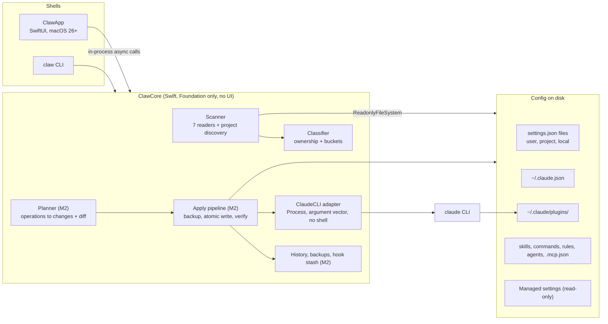
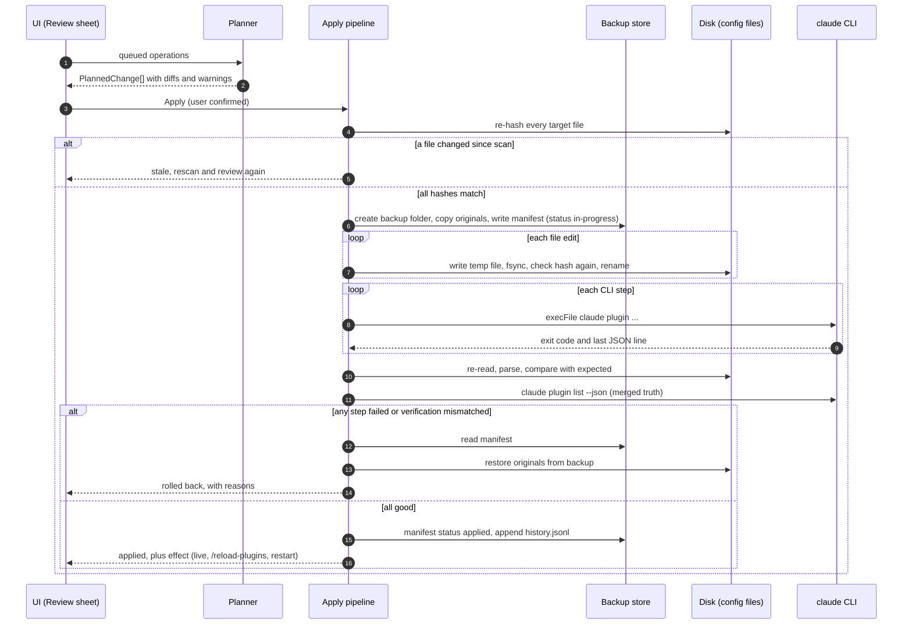

# Technical Design: Claw

> **Stack: Swift 6 + SwiftUI, app name Claw** ([ADR-0001](adr/0001-stack-swift-swiftui.md), [ADR-0002](adr/0002-name-claw.md)). Updated 2026-11-04. TypeScript blocks in `TECHNICAL-DESIGN.md` are kept as the behaviour spec; the Swift code in `Sources/ClawCore` implements them.


Version 0.1 · 2026-11-04 · Status: draft for implementation
Companion files: [`OVERVIEW.md`](OVERVIEW.md) · [`PRD.md`](PRD.md) · [`ROADMAP.md`](ROADMAP.md)

Tags: **[V]** verified in the official Claude Code docs on 2026-11-04 (page named; Claude Code version given where the docs give one) · **[A]** assumption or recommendation · **[U]** unknown, closed by spike `S*` (section 15).
The installed Claude Code version on the target Mac was **not** inspected. Check `claude --version` and `claude plugin <subcommand> --help` before relying on any flag.

---

## 1. Architecture overview

Design rules that drive everything else:

1. **One core, many shells.** All behaviour lives in `ClawCore`, a UI-free Swift library that builds on macOS and Linux. The `claw` CLI and the SwiftUI app are thin shells. [A]
2. **Scan reads, apply writes, and they never share a code path.** Readers only receive a `ReadonlyFileSystem`.
3. **Prefer the official CLI for anything that touches Claude Code's own records** (plugin install, uninstall, marketplaces, MCP add and remove). Write files directly only where no CLI exists. [A]
4. **Every write goes through one pipeline**: plan, review, backup, atomic write, verify, record.
5. **Never execute scanned content** (hooks, MCP commands, scripts).



## 2. Stack decision

### 2.1 Build, fork or reuse

| Option | Fit | Verdict |
| :- | :- | :- |
| Fork HayriCan/SkillForge (Tauri 2, Svelte 5, TypeScript; MIT) | When checked on 2026-11-04: 4 commits, 0 stars, no releases; documented enable/disable only for MCP servers | Rejected ([ADR-0003](adr/0003-no-fork.md)) |
| New app, TypeScript core + Electron + React | Earlier recommendation of these docs | Superseded by ADR-0001 |
| New app, Tauri 2 + Rust | Small bundle, web UI | Not chosen |
| **New app, native Swift + SwiftUI** | Real Liquid Glass and macOS 26/27 system chrome; one language for core, CLI and app; `ClawCore` still builds and tests on Linux | **Chosen** ([ADR-0001](adr/0001-stack-swift-swiftui.md)) |

Trade-offs: the SwiftUI app compiles only on macOS (CI needs a macOS runner); no ready-made library for minimal-diff JSON editing, so M2 writes one; Foundation on Linux behaves differently in places (`docs/spikes.md` F1 to F4).

### 2.2 Technology choices

| Area | Choice | Notes |
| :- | :- | :- |
| Language | Swift 6 language mode, `swift-tools-version: 6.2` | Strict concurrency: shared types are `Sendable`; UI state is `@MainActor` |
| Build | Swift Package Manager; an Xcode app target is added in M6 for signing | Verified building with Swift 6.4.2 on Linux |
| Dependencies | **None** (Foundation, SwiftUI, Observation, Testing) | A new dependency needs an ADR |
| JSON reading | `JSONValue` (tolerant tree) after `StrictJSON.validate` (RFC 8259, rejects comments and trailing commas like Node's `JSON.parse`) | Settings files are strict JSON [V `settings`] |
| JSON editing (M2) | Own byte-range editor over the strict scanner: replace only the value's bytes, keep key order, indentation, EOL and unknown keys | Replaces `jsonc-parser` from the TypeScript spec |
| Frontmatter | `Frontmatter` parser (key: value, quotes, block scalars) | Enough for `name`, `description` and flags [V `skills`] |
| Processes | `Foundation.Process`, argument vector, closed stdin, timeout, cancellation | Section 4 |
| Tests | Swift Testing (`import Testing`); in-memory `ReadonlyFileSystem`; fake `CommandRunner` | Section 13 |
| Logging | `os.Logger` (unified logging) with `.private` interpolation by default | Section 12 |
| UI | SwiftUI on macOS 26+: `NavigationSplitView`, `Table`, `inspector`, sheets, system toolbar (Liquid Glass from the system) | Section 10 |
| Formatting | `swift format` (bundled with the toolchain), `.swift-format` in the repo, `--strict` in CI | |
| Packaging (M6) | Developer ID, hardened runtime, `notarytool`, `.dmg` | Section 14 |

### 2.3 Spec to code map

| Spec in this document (TypeScript) | Swift implementation |
| :- | :- |
| `packages/contracts/src/model.ts` | `Sources/ClawCore/Model/Model.swift` |
| `packages/contracts/src/item.ts` | `Sources/ClawCore/Model/Item.swift` |
| `packages/contracts/src/plan.ts` | M2 (`Sources/ClawCore/Plan/`) |
| `packages/core/src/classify-plugin.ts` | `Sources/ClawCore/Classify/PluginClassifier.swift` |
| `packages/core/src/effective-plugin-state.ts` | `Sources/ClawCore/State/EffectivePluginState.swift` |
| `packages/core/src/redact.ts` | `Sources/ClawCore/Security/Redactor.swift` |
| `packages/core/src/json-edit.ts` | M2 (`Sources/ClawCore/Write/JSONEdit.swift`) |
| `packages/core/src/atomic-write.ts` | M2 (`Sources/ClawCore/Write/AtomicWrite.swift`) |

## 3. Configuration surface (verified contracts)

### 3.1 File map and read allowlist

The scan may read **only** these locations. Everything else is out of bounds (`FR-F02-8`).

| Path | Scope | Written by | Used for | Status |
| :- | :- | :- | :- | :- |
| `~/.claude/settings.json` | User | You, Claude Code | `enabledPlugins`, `skillOverrides`, `claudeMdExcludes`, `permissions.deny`, `hooks`, `disabledMcpjsonServers`, `disableAllHooks`, `extraKnownMarketplaces`, `syncClaudeAi*` | [V] `settings` |
| `<project>/.claude/settings.json` | Project (shared) | Team | same keys | [V] |
| `<project>/.claude/settings.local.json` | Local | You. Claude Code adds `**/.claude/settings.local.json` to global git excludes when it writes the file; it sits at the git repo root (v2.1.211 or later) | same keys | [V] |
| `/Library/Application Support/ClaudeCode/managed-settings.json` and `managed-settings.d/*.json` | Managed | IT | read-only | [V] `managed-settings` |
| macOS configuration profile, preference domain `com.anthropic.claudecode` | Managed | MDM | read-only; how to read it from the app [U] S10 | domain [V] |
| `/Library/Application Support/ClaudeCode/managed-mcp.json`, `CLAUDE.md` | Managed | IT | read-only | [V] |
| `~/.claude.json` | App state | **Claude Code** | MCP servers (local and user scope), per-project state (`projects` key), `disabledMcpServers`; backups go to `~/.claude/backups/` (five newest kept) | purpose [V] `claude-directory`, `mcp`; **structure [U] S1** |
| `~/.claude/plugins/installed_plugins.json` | n/a | Claude Code | per install: `scope`, `installPath`, `version` | [V] `plugins/loading` |
| `~/.claude/plugins/known_marketplaces.json` | n/a | Claude Code | per marketplace: `source`, `installLocation`, `lastUpdated`, `autoUpdate` | [V] |
| `~/.claude/plugins/known_marketplaces_claudeai.json`, `flagged-plugins.json` | n/a | Claude Code | claude.ai marketplaces; delisted plugins | [V] |
| `~/.claude/plugins/cache/<marketplace>/<plugin>/<version>/` | n/a | Claude Code | copied plugin files | [V] |
| `~/.claude/plugins/marketplaces/<name>/` | n/a | Claude Code | cloned marketplaces (not for local `file` / `directory` sources) | [V] |
| `~/.claude/plugins/data/<plugin-id>/`, `synced/`, `.trash/` | n/a | Claude Code | plugin data; synced plugins; removed synced plugins | [V] |
| `~/.claude/skills/<name>/SKILL.md`, `<project>/.claude/skills/<name>/SKILL.md`, `<subdir>/.claude/skills/…` | User, Project, Nested | You | skills; a folder holding `.claude-plugin/plugin.json` is a skills-directory plugin | [V] `skills`, `plugins/loading` |
| `~/.claude/skills/synced/`, `~/.claude/skills/.trash/` | Synced | Claude Code | claude.ai skill sync (download only) | [V] |
| `~/.claude/commands/*.md`, `<project>/.claude/commands/*.md` | User, Project | You | commands | [V] `claude-directory` |
| `~/.claude/agents/*.md`, `<project>/.claude/agents/*.md` | User, Project | You | subagents | [V] `sub-agents` |
| `~/.claude/CLAUDE.md`, `~/.claude/rules/**/*.md` | User | You | rules | [V] `memory` |
| `<project>/CLAUDE.md` or `<project>/.claude/CLAUDE.md`, `<project>/CLAUDE.local.md`, `<project>/.claude/rules/**/*.md` | Project, Local | Team, You | rules | [V] |
| `<project>/.mcp.json` | Project | Team | MCP servers | [V] `mcp` |

Relocation: `CLAUDE_CODE_PLUGIN_CACHE_DIR` moves the plugins root [V]; `CLAUDE_CONFIG_DIR` relocates the config directory [V per `settings`; effect on `~/.claude.json` [U] S8]. The app must honour both when set in its own environment or in preferences.

**Never write to:** `~/.claude/backups/`, `~/.claude/plugins/` (use the CLI), `~/.claude/plugins/.trash/`, managed locations.

App-owned paths [A]: `~/Library/Application Support/<App>/` (`projects.json`, `history.jsonl`, `stash/`, `prefs.json`), `~/.claude.bak/<timestamp>/` (backups), `~/Library/Logs/<App>/`.

### 3.2 Precedence and effective state

[V] `settings`: Managed > `--settings` flag > Local > Project > User. `permissions.allow` style lists merge. [V] `plugins/loading`: for `enabledPlugins` the highest-precedence source that mentions the id decides; sources lowest to highest are `--add-dir` (only `true` counts), `user`, `project`, `local`, `flag`, `managed` (`true` force-enables, `false` blocks).

Consequences for the app:

- The app **cannot** see the `flag` source; it says so in the "why still loads" explanation.
- After a write the app asks the CLI for the merged truth (`claude plugin list --json`, field `enabled`) and compares with its own computation (section 6). A mismatch is shown, not hidden.

### 3.3 Per-concept contracts

#### Plugins

| Topic | Contract |
| :- | :- |
| Identity | `name@origin`. `origin` is a marketplace name, or reserved `inline` (session only), `skills-dir` (plugin folder under `~/.claude/skills/` or `<project>/.claude/skills/`), `synced` (claude.ai). These three names cannot be marketplace names [V] |
| List | `claude plugin list --json`: array; always `id`, `version`, `scope` (`user`, `project`, `local`, `managed`, `session`, `synced`), `enabled`, `installPath`; optional `readFromFolder` and `folderVersion` (v2.1.289 or later), `installedAt`, `lastUpdated`, `projectPath`, `mcpServers`, `errors`, `notes`, `errorDetails` (v2.1.268), `projectEnabled` (v2.1.285). `--available` adds uninstalled marketplace plugins [V `plugins/cli-reference`] |
| Marketplaces | `claude plugin marketplace list --json`: `name`, `source` (`github`, `git`, `url`, `directory`, `file`, `claudeai`), `repo`, `url`, `path`, `ref`, `installLocation` (all strings) [V] |
| Enable / disable | `enabledPlugins["name@origin"]` boolean in any settings file. CLI: `claude plugin enable\|disable <plugin> [-s\|--scope user\|project\|local] [--json]`. Scope is auto-detected in the order local, project, user. Enabling an already-enabled plugin exits `1` ("already enabled"); with `--json` the result has `failureCode: "already_in_goal_state"` [V] |
| Add | `claude plugin marketplace add <source> [--scope user\|project\|local] [--sparse …] [--json]` (`--scope` has no `-s`); `<source>` forms: `owner/repo[#ref\|@ref]` (github), `user@host:path` or `https://….git` (git), other `https://` (url), `./path` `../path` `/path` `~/path` to a directory (`directory`) or to a `.json` file (`file`). Then `claude plugin install <name>@<marketplace> [-s user\|project\|local] [--json] [-y]` [V] |
| Remove | `claude plugin uninstall <plugin> [-s …] [--keep-data] [--json]`; also `claude plugin marketplace remove <name> [--scope …]`. Without `--keep-data` the plugin's data directory is deleted when it is removed from its last scope [V] |
| In place or copied | Relative-path plugins of a marketplace added from a **local path** load **in place** (edits apply at next session or `/reload-plugins`, no version bump). Every other marketplace plugin is copied to `cache/<marketplace>/<plugin>/<version>/`. `--plugin-dir` and skills-directory plugins also load in place [V `plugins/loading`] |
| Components | Standard layout: `.claude-plugin/plugin.json` (optional), `skills/`, `commands/`, `agents/`, `hooks/hooks.json`, `.mcp.json`; the manifest may declare other paths (`skills`, `commands`, `agents`, `hooks`, `mcpServers`, …) [V `plugins/manifest-reference`] |
| Apply timing | `/reload-plugins` or a new session [V] |
| Unknowns | A bug report suggests directory-marketplace installs may not be written to `enabledPlugins` [U] S3 |

#### Skills

| Topic | Contract |
| :- | :- |
| Locations | Enterprise (managed directory), `~/.claude/skills/<name>/SKILL.md`, `<project>/.claude/skills/<name>/SKILL.md`, nested `<subdir>/.claude/skills/`, `--add-dir` directories, plugin `skills/`, claude.ai synced (`~/.claude/skills/synced/`). The macOS path of the enterprise skills directory is [U] S10 (Linux example: `/etc/claude-code/.claude/skills/`) |
| Frontmatter | All optional; `name`, `description`, `when_to_use`, `argument-hint`, `arguments`, `disable-model-invocation`, `user-invocable`, `allowed-tools`, `disallowed-tools`, `model`, `effort`, `context`, `agent`, `background`, `hooks`, `paths`, `shell`, plus informational `metadata`, `license`, `compatibility` [V `skills`] |
| Precedence | Enterprise > personal > project for the same name; plugin skills are namespaced `plugin-name:skill-name` and both load; nested skills load alongside root skills [V] |
| Disable | `skillOverrides: { "<name>": "on" \| "name-only" \| "user-invocable-only" \| "off" }` in settings; the `/skills` menu writes it to `.claude/settings.local.json`; **plugin skills are not affected** [V]. Also `permissions.deny` with `Skill`, `Skill(name)` (exact) or `Skill(name *)` (prefix). Namespaced plugin names in deny rules [U] S2. Frontmatter `disable-model-invocation: true` and `user-invocable: false` are edits to the file, not toggles |
| Synced | Download only; local edits are overwritten; opt out with `syncClaudeAiSkills: false` (moves them to `~/.claude/skills/.trash/`) [V] |
| Apply timing | Watched; add, edit, remove apply live. A **new** top-level skills directory needs `/reload-skills` [V] |

#### Commands

[V] `claude-directory`, `skills`: `commands/deploy.md` creates `/deploy` the same way `skills/deploy/SKILL.md` does; commands are merged into skills; a skill wins over a same-name command; command files accept the same frontmatter except `name` and `paths`. Whether `skillOverrides` accepts a command name [U] S2. Plugin `commands/` follow the same rules.

#### Rules

| Topic | Contract |
| :- | :- |
| Load order | CLAUDE.md and CLAUDE.local.md from the working directory **and every directory above it**, concatenated from filesystem root down; `CLAUDE.local.md` after `CLAUDE.md` in each directory; subdirectory files load on demand [V `memory`] |
| Rules files | `.claude/rules/**/*.md` and `~/.claude/rules/**/*.md`; no `paths:` frontmatter means loaded at session start, with `paths:` (glob list) loaded when Claude reads a matching file [V] |
| Disable | `claudeMdExcludes`: array of glob patterns matched against **absolute** paths, any settings layer, arrays merge; managed CLAUDE.md cannot be excluded; for a symlinked rules file a pattern matching either the link path or the target excludes it (v2.1.239 or later) [V] |
| Apply timing | [U] S4 |

#### Subagents

| Topic | Contract |
| :- | :- |
| Priority | Managed settings, `--agents` flag, `.claude/agents/`, `~/.claude/agents/`, plugin `agents/`; same name: higher priority wins [V `sub-agents`] |
| Frontmatter | `name` (required, up to 256 chars, no `:`), `description` (required), `tools`, `disallowedTools`, `model`, `permissionMode`, `skills`, `mcpServers`, `hooks`, `memory`, `maxTurns`, `effort`, `isolation`, `background`, `omitClaudeMd`, `color`, `initialPrompt`, `autoCompactWindow`, `experimental`; unknown fields ignored; plugin subagents ignore `permissionMode`, `mcpServers`, `hooks` [V] |
| Disable | `permissions.deny: ["Agent(<name>)"]`; `Task(...)` is an alias since v2.1.63 [V]. Plugin subagent names [U] S6 |
| `/agents` | In current versions it only prints a reminder to edit the folders; the interactive library existed up to v2.1.197 [V]. This is part of the app's value |

#### MCP servers

| Topic | Contract |
| :- | :- |
| Scopes | `local` (default; current project only; stored in `~/.claude.json` under the project path), `project` (`.mcp.json`, shared), `user` (all projects; `~/.claude.json`). Local-scope MCP is **not** in `.claude/settings.local.json` [V `mcp`]. Precedence: local, project, user, plugin, then claude.ai connectors [V] |
| CLI | `claude mcp add --transport http\|sse <name> <url>`; `claude mcp add [options] <name> -- <command> [args…]` (stdio); `add-json <name> '<json>'`; `list`; `get <name>`; `remove <name> [--scope …]`; `reset-project-choices`; `login`, `logout`; flags `--scope\|-s local\|project\|user`, `--env\|-e KEY=value`, `--header\|-H`. `claude mcp list` has no documented `--json` [V] |
| `.mcp.json` | Top key `mcpServers`; `type` is `http`, `streamable-http`, `sse`, `ws` or `sdk` (skipped in `.mcp.json`); no `type` means stdio; stdio fields `command`, `args`, `env`; remote fields `url`, `headers`, `headersHelper`; also `timeout`, `alwaysLoad`, `oauth`; `${VAR}` and `${VAR:-default}` expansion in `command`, `args`, `env`, `url`, `headers` [V] |
| Disable | **`.mcp.json` servers:** settings keys `enabledMcpjsonServers`, `disabledMcpjsonServers` (a disabled entry rejects the server in every permission mode), `enableAllProjectMcpServers`; value shapes [U] S7. **All other servers:** the `/mcp` toggle stores `disabledMcpServers` (opt-out list) and `enabledMcpServers` (opt-in for default-off built-ins) **per project in `~/.claude.json`**; these are unrelated to the `…Mcpjson…` keys [V]. `deniedMcpServers` and `allowedMcpServers` exist as settings keys (block or allow by URL, command or name) [V one-line meaning only; semantics [U] S7] |
| Plugin MCP | Defined in the plugin's `.mcp.json` or inline in `plugin.json`; start with the plugin; registered as `plugin:<plugin-name>:<server-name>`; toggled in `/mcp` or by the plugin [V] |
| Secrets | `env`, `headers`, `oauth` and URLs may hold secrets. `claude mcp remove` of a remote server deletes stored OAuth tokens and client registration [V] |

#### Hooks

| Topic | Contract |
| :- | :- |
| Locations | User, project and local settings, managed policy, plugin `hooks/hooks.json`, skill frontmatter (after invocation), subagent frontmatter (while running). Entries **merge across levels** [V `hooks`] |
| Shape | `{ "hooks": { "<Event>": [ { "matcher": "<pattern>", "hooks": [ { "type": "command", "command": "…", "timeout": 600 } ] } ] } }`. Handler `type`: `command`, `http`, `mcp_tool`, `prompt`, `agent`. Optional `if`, `args`. Plugin `hooks.json` may carry a top-level `description` [V] |
| Events | SessionStart, Setup, UserPromptSubmit, UserPromptExpansion, PreToolUse, PermissionRequest, PermissionDenied, PostToolUse, PostToolUseFailure, PostToolBatch, Notification, MessageDisplay, SubagentStart, SubagentStop, TaskCreated, TaskCompleted, Stop, StopFailure, TeammateIdle, InstructionsLoaded, ConfigChange, CwdChanged, DirectoryAdded, FileChanged, WorktreeCreate, WorktreeRemove, PreCompact, PostCompact, PreModelSwitch, PostModelSwitch, Elicitation, ElicitationResult, SessionEnd [V] |
| Disable | **No per-hook disable**: "There is no way to disable an individual hook while keeping it in the configuration." Only `disableAllHooks: true` (value left after precedence; a `false` in project settings overrides a `true` in user settings; managed hooks only by managed-level `disableAllHooks`). `allowManagedHooksOnly` (managed) blocks user, project, local and plugin hooks [V]. The app therefore removes and stashes (F15) |
| Whether the matcher is required | [A] optional for events without a tool (for example `Stop`); confirm in S9 |

### 3.4 When a change takes effect

| Change | Takes effect | Status |
| :- | :- | :- |
| Plugin enable, disable, install, uninstall, update | `/reload-plugins` or new session | [V] |
| Edit of an in-place plugin | Next session or `/reload-plugins`, no version bump | [V] |
| Skill add, edit, remove (existing skills directory) | Live | [V] |
| New top-level skills directory | `/reload-skills` | [V] |
| Change to a plugin's hooks, `.mcp.json`, agents | `/reload-plugins` | [V] |
| Settings file edit | Files are watched and reloaded; a `ConfigChange` hook fires | [V] `settings` |
| `skillOverrides`, `claudeMdExcludes`, `permissions.deny`, hook removal | Expected live via settings reload; verify | [A] S4, S9 |
| MCP changes | Expected via `/mcp` reconnect or restart; verify | [A] S4 |

---

## 4. Claude CLI adapter

| Rule | Detail |
| :- | :- |
| Invocation | `execFile` with an argument array. **Never** a shell string (`NFR-SEC-2`) |
| Name validation | Plugin ids and marketplace names must match `^[A-Za-z0-9][A-Za-z0-9._-]{0,127}(@[A-Za-z0-9][A-Za-z0-9._-]{0,127})?$` [A] before use; paths must be absolute and exist |
| Binary resolution | A GUI app started from Finder does not inherit your shell `PATH` [A]. Order: path in preferences, `$SHELL -lc 'command -v claude'` (login shell), then common install locations. Cache with a "re-detect" button |
| Version | `claude --version` at start; compare with feature gates (section 4.1); cache for the session |
| Environment | Pass through `CLAUDE_CONFIG_DIR` and `CLAUDE_CODE_PLUGIN_CACHE_DIR` if set; nothing else beyond a minimal `PATH` and `HOME` |
| Timeouts | 30 s for list and details, 120 s for install, update and marketplace add; kill on cancel |
| Parsing | Parse **only** the last stdout line for `--json` on plugin commands ("Parse only that line, because Claude Code prints any command the marketplace declares ahead of it") [V] |
| Errors | Map exit codes: `0` ok, `1` failure (with `--json`, read `failureCode`), `validate` also `2` (validator failed, message on stderr) [V]. Unknown codes are surfaced verbatim, redacted |
| Marketplace-declared commands | Never pass `-y` blindly. Show the user what a marketplace-declared install command will run; the documented non-interactive path is `--accept-command <sha256>` from a previous `--json` run (v2.1.271 or later) [V] |

### 4.1 Commands and version gates

| Command | Used by | Gate |
| :- | :- | :- |
| `claude plugin list --json [--available] [--data-size [plugin]]` | Scan (plugins), verification | `--data-size` v2.1.285; `readFromFolder`, `folderVersion` v2.1.289 |
| `claude plugin marketplace list --json` | Scan | n/a |
| `claude plugin details <plugin>` | Detail view [A] | check `--help` |
| `claude plugin install / uninstall / update / enable / disable … [--json]` | Apply | `--json` v2.1.268; `uninstall` settings check v2.1.282; `update` default-scope behaviour v2.1.281 (before it, pass `--scope`) |
| `claude plugin marketplace add / remove / update [--json]` | Add, remove | `--json` v2.1.287 |
| `claude plugin validate <path> [--strict] [--json]` | Add plugin | `--json` v2.1.259 |
| `claude plugin init <name> …` | New personal plugin | flags in PRD FR-F09-11 [V]; confirm with `--help` |
| `claude mcp add / add-json / remove / list / get` | Add, remove, scan (names only) | check `--help` |

---

## 5. Ownership classification

Deterministic, explainable, conservative (`FR-F14-*`). Every classification carries `rule` and `evidence`.

### 5.1 Plugins

| Rule | Condition | Result |
| :- | :- | :- |
| P1 | id has no `@origin` | Orphaned (malformed) |
| P2 | origin `synced` | Synced |
| P3 | origin `skills-dir` | Personal |
| P4 | origin `inline` | Personal, session-only, not persistent [A] |
| P5 | origin is a marketplace name not present in the marketplace list | Orphaned (marketplace missing) |
| P6 | marketplace source `directory` or `file`, **and** the plugin loads in place (`readFromFolder` present, or the marketplace entry's `source` is a relative path) | Personal. Evidence includes the folder and, if present, its git remote, so a clone of someone else's repo is visible |
| P7 | any other marketplace plugin (including a local marketplace whose entry points to an external source, which is copied into the cache) | Marketplace |
| P8 | id in `enabledPlugins` but no install record and no marketplace entry for it | Orphaned (declared, not installed) |

P8 is evaluated by the scanner, which sees the settings layers; it is not part of `classifyPlugin` below, which receives only installed records.
If the CLI is older than v2.1.289 and the entry's source cannot be read, P6 cannot be proven: the result is Marketplace, with the evidence "cannot prove in-place".
A plugin load error (`errors` in `plugin list --json`) is a **problem on the item**, not an ownership change, so a broken Personal plugin stays editable.

### 5.2 Other concepts

| Concept | Condition | Ownership |
| :- | :- | :- |
| Skill, command, rule, subagent | file under `~/.claude/…` | Personal, scope User |
| same | file under `<registered project>/.claude/…` or project `CLAUDE.md`, `CLAUDE.local.md` | Personal, scope Project (or Local for `CLAUDE.local.md`) |
| Skill | under `~/.claude/skills/synced/` | Synced |
| any | under a plugin's `installPath` or `readFromFolder` | From plugin (`providedBy` = plugin id) |
| any | under `/Library/Application Support/ClaudeCode/` | Managed |
| MCP | defined in `~/.claude.json` (user or local) or `.mcp.json` | Personal (scope User, Local, Project) |
| MCP | defined by a plugin; or a claude.ai connector; or managed | From plugin; Synced [A]; Managed |
| Hook | in a user, project or local settings file | Personal |
| Hook | in a plugin `hooks.json`; skill or subagent frontmatter; managed policy | From plugin; read-only (frontmatter); Managed |

Repository content you did not author (a cloned project) is classified by location, so its project files show as Personal for **editing purposes** but carry a "repository content" marker (`FR-F03-6`); the app never executes them.

### 5.3 Reference implementation

TypeScript spec below; Swift implementation in `Sources/ClawCore/Classify/PluginClassifier.swift` (section 2.3).

```ts
// file: packages/contracts/src/model.ts
export const CONCEPTS = ['plugins', 'skills', 'commands', 'rules', 'agents', 'mcp', 'hooks'] as const;
export type ConceptId = (typeof CONCEPTS)[number];

export type SettingsScope = 'managed' | 'user' | 'project' | 'local';
export type Ownership = 'personal' | 'market' | 'synced' | 'plugin' | 'managed' | 'orphan';
export type Bucket = 'yours' | 'readonly' | 'attention';

export const bucketOf = (o: Ownership): Bucket =>
  o === 'personal' ? 'yours' : o === 'orphan' ? 'attention' : 'readonly';

export interface Classification {
  readonly ownership: Ownership;
  readonly rule: string;
  readonly evidence: readonly string[];
}

export type MarketplaceSource = 'github' | 'git' | 'url' | 'directory' | 'file' | 'claudeai';

export interface MarketplaceRecord {
  readonly name: string;
  readonly source: MarketplaceSource;
  readonly path?: string;
}

export interface PluginRecord {
  readonly id: string;
  readonly installPath: string;
  readonly readFromFolder?: string;
}
```

```ts
// file: packages/core/src/classify-plugin.ts
import type { Classification, MarketplaceRecord, PluginRecord } from '@claw/contracts';

export interface PluginClassifyContext {
  readonly markets: ReadonlyMap<string, MarketplaceRecord>;
  /** true/false when the marketplace entry's source was read; undefined when unknown. */
  readonly entrySourceIsRelative?: boolean;
  /** git remote URL of the marketplace folder, when it is a repository. */
  readonly gitRemote?: string;
}

export function classifyPlugin(p: PluginRecord, ctx: PluginClassifyContext): Classification {
  const at = p.id.lastIndexOf('@');
  if (at <= 0 || at === p.id.length - 1) {
    return { ownership: 'orphan', rule: 'P1', evidence: [`id "${p.id}" has no @origin`] };
  }
  const origin = p.id.slice(at + 1);

  if (origin === 'synced') return { ownership: 'synced', rule: 'P2', evidence: ['origin is synced (claude.ai account)'] };
  if (origin === 'skills-dir') return { ownership: 'personal', rule: 'P3', evidence: [`skills-directory plugin at ${p.installPath}`] };
  if (origin === 'inline') return { ownership: 'personal', rule: 'P4', evidence: ['session-only plugin (--plugin-dir)'] };

  const market = ctx.markets.get(origin);
  if (!market) {
    return { ownership: 'orphan', rule: 'P5', evidence: [`marketplace "${origin}" is not registered`] };
  }

  const isLocal = market.source === 'directory' || market.source === 'file';
  const loadsInPlace = p.readFromFolder !== undefined || ctx.entrySourceIsRelative === true;
  if (isLocal && loadsInPlace) {
    const evidence = [`local ${market.source} marketplace at ${market.path ?? '(unknown path)'}`, 'loads in place, not copied to the cache'];
    if (ctx.gitRemote) evidence.push(`git remote: ${ctx.gitRemote}`);
    return { ownership: 'personal', rule: 'P6', evidence };
  }

  const why = isLocal ? 'cannot prove the plugin loads in place' : `${market.source} marketplace`;
  return { ownership: 'market', rule: 'P7', evidence: [`marketplace "${origin}": ${why}`] };
}
```

---

## 6. Effective state

```ts
// file: packages/core/src/effective-plugin-state.ts
export type PluginSource = 'add-dir' | 'user' | 'project' | 'local' | 'flag' | 'managed';

/** Lowest to highest precedence ([V] plugins/loading). */
export const PLUGIN_SOURCE_ORDER: readonly PluginSource[] = ['add-dir', 'user', 'project', 'local', 'flag', 'managed'];

export interface PluginLayer {
  readonly source: PluginSource;
  readonly file?: string;
  readonly enabledPlugins?: Readonly<Record<string, boolean>>;
}

export interface EffectiveState {
  readonly enabled: boolean;
  readonly decidedBy: PluginSource | null;
  readonly file?: string;
  /** Lower-precedence layers that disagree with the winner (for "still loads" warnings). */
  readonly overridden: readonly { readonly source: PluginSource; readonly value: boolean }[];
}

export function resolveEnabled(id: string, layers: readonly PluginLayer[], fallback = false): EffectiveState {
  let enabled = fallback;
  let decidedBy: PluginSource | null = null;
  let file: string | undefined;
  const seen: { source: PluginSource; value: boolean }[] = [];

  for (const source of PLUGIN_SOURCE_ORDER) {
    for (const layer of layers) {
      if (layer.source !== source) continue;
      const value = layer.enabledPlugins?.[id];
      if (value === undefined) continue;
      if (source === 'add-dir' && value !== true) continue; // only true counts
      seen.push({ source, value });
      enabled = value;
      decidedBy = source;
      file = layer.file;
    }
  }
  const overridden = seen.filter((s) => s.value !== enabled);
  return { enabled, decidedBy, ...(file !== undefined ? { file } : {}), overridden };
}
```

The CLI's merged `enabled` is the authority; this function explains it. A disagreement is surfaced in the UI ("The app and Claude Code disagree about this plugin").

---

## 7. Domain model

```ts
// file: packages/contracts/src/item.ts
import type { Bucket, Classification, ConceptId, SettingsScope } from './model';

export type VerificationStatus = 'verified' | 'assumed' | 'unknown';

export type Locator =
  | { readonly kind: 'file'; readonly path: string }
  | { readonly kind: 'dir'; readonly path: string }
  | { readonly kind: 'json'; readonly file: string; readonly pointer: string } // RFC 6901
  | { readonly kind: 'hook'; readonly file: string; readonly event: string; readonly groupIndex: number; readonly handlerIndex: number }
  | { readonly kind: 'plugin-component'; readonly pluginId: string; readonly path: string }
  | { readonly kind: 'remote'; readonly origin: 'claude.ai' | 'managed' };

export type ControlMechanism =
  | 'enabledPlugins' | 'skillOverrides' | 'claudeMdExcludes' | 'permissionsDeny'
  | 'disabledMcpjsonServers' | 'disabledMcpServers' | 'hookStash' | 'syncSetting' | 'none';

export interface ControlRef {
  readonly mechanism: ControlMechanism;
  /** Display string, for example enabledPlugins["ecc@ecc"]. */
  readonly key: string;
  readonly status: VerificationStatus;
}

export interface Capabilities {
  readonly edit: boolean;
  readonly toggle: boolean;
  readonly remove: boolean;
  readonly removeLabel: 'Uninstall' | 'Move to backup' | 'Remove server' | 'Remove entry' | null;
  /** Shown as a tooltip when an action is unavailable. */
  readonly reason?: string;
}

export interface Problem {
  readonly severity: 'error' | 'warning' | 'note';
  readonly message: string;
  readonly file?: string;
}

export interface Item {
  /** Stable: `${concept}:${scope}:${locator-derived key}`. */
  readonly id: string;
  readonly concept: ConceptId;
  readonly name: string;
  readonly description: string;
  readonly scope: SettingsScope | 'plugin' | 'synced';
  readonly projectPath?: string;
  readonly classification: Classification;
  readonly bucket: Bucket;
  readonly locator: Locator;
  readonly enabled: boolean;
  readonly enabledBy?: { readonly source: string; readonly file?: string };
  readonly control: ControlRef;
  readonly capabilities: Capabilities;
  readonly providedBy?: string;
  readonly provides?: readonly ConceptId[];
  readonly repositoryContent: boolean;
  readonly problems: readonly Problem[];
}

export interface ScanResult {
  readonly target: { readonly kind: 'mac' } | { readonly kind: 'folder'; readonly path: string };
  readonly startedAt: string;
  readonly finishedAt: string;
  readonly partial: boolean;
  readonly claudeCodeVersion: string | null;
  readonly items: readonly Item[];
  readonly problems: readonly Problem[];
}
```

Operations and plans:

```ts
// file: packages/contracts/src/plan.ts
import type { ConceptId, SettingsScope } from './model';

export type Operation =
  | { readonly op: 'setEnabled'; readonly itemId: string; readonly enabled: boolean; readonly writeScope: SettingsScope; readonly projectPath?: string }
  | { readonly op: 'remove'; readonly itemId: string; readonly keepData?: boolean }
  | { readonly op: 'add'; readonly concept: ConceptId; readonly spec: Readonly<Record<string, unknown>> }
  | { readonly op: 'restore'; readonly backupId: string };

export interface FileEdit {
  readonly file: string;
  /** null = file does not exist yet. */
  readonly before: string | null;
  /** null = file is removed (moved to backup). */
  readonly after: string | null;
  readonly reason: string;
}

export interface CliStep {
  readonly argv: readonly string[]; // after the binary, for example ['plugin', 'uninstall', 'x@y', '--scope', 'user']
  readonly reason: string;
}

export type Effect = 'live' | 'reload-plugins' | 'restart' | 'verify';

export interface PlannedChange {
  readonly id: string;
  readonly operation: Operation;
  readonly edits: readonly FileEdit[];
  readonly moves: readonly { readonly from: string; readonly to: 'backup' }[];
  readonly cli: readonly CliStep[];
  readonly stash?: { readonly action: 'put' | 'take'; readonly hookId: string };
  readonly effect: Effect;
  readonly warnings: readonly string[];
}
```

---

## 8. Scan engine

### 8.1 Structure

| Part | Responsibility |
| :- | :- |
| `ReadonlyFs` | Interface exposing only `readFile`, `readdir`, `stat`, `lstat`, `realpath`, `exists`. No write methods exist on it |
| `Reader<C>` (seven of them) | `read(ctx): AsyncIterable<RawItem>`; emits `ProgressEvent` per directory or file batch |
| `Classifier` | Section 5 |
| `StateResolver` | Section 6, plus per-concept enable state from the keys in 3.3 |
| `Scanner` | Runs readers with a shared `AbortSignal`; merges, classifies, returns `ScanResult` (`partial: true` when aborted) |

### 8.2 Targets

| Target | Roots read |
| :- | :- |
| **This Mac** | User scope (`~/.claude/**` per allowlist, `~/.claude.json`), managed locations if present, plugin cache and in-place plugin folders (from `plugin list --json`), every **registered project**, every project path found under `projects` in `~/.claude.json` [A, shape U S1] |
| **One folder** | That folder's `.claude/` (settings, skills, commands, rules, agents), `.mcp.json`, `CLAUDE.md`, `CLAUDE.local.md`, plus a bounded walk for nested `.claude/` directories |

Bounded walk: depth at most 4 [A], ignore `node_modules`, `.git`, `dist`, `build`, `.next`, `target`; stop after 5 000 directories or 2 s [A]; report "walk truncated" as a note.

Not done by default: crawling the disk. The opt-in **Find projects…** action takes user-chosen folders and looks for `.claude/`, `.mcp.json`, `CLAUDE.md`. Reading `~/Documents`, `~/Desktop` and `~/Downloads` triggers macOS privacy prompts [A] S10, so the app asks first and explains.

### 8.3 Safety rules inside readers

- Resolve `realpath` and refuse paths that leave the root (symlink escape), except the documented dotfile-manager case where `~/.claude/*` is a symlink: allow when the link target is a regular file inside the user's home and record both paths.
- File size cap 2 MB per config file except `~/.claude.json` (stream or parse once, keep only needed keys, never log it).
- Frontmatter parse failures become problems, never exceptions.
- Never `eval`, never run a command found in a file.

### 8.4 Progress events

`{ type: 'concept-start' | 'file-read' | 'items-found' | 'concept-done' | 'problem', concept, count?, file? }`. The UI computes percent from concepts done and files read; it does not invent progress.

---

## 9. Plan and apply

### 9.1 Planning

The planner is **pure**: `(ScanResult, Operation[]) -> PlannedChange[]`. It reads file contents captured at scan time (hash and text), computes the "after" text with minimal JSON edits, and emits warnings (overridden by a higher scope, managed lock, guard hook, OAuth deletion, plugin data deletion).

Minimal JSON edit helper (preserves unknown keys, order and indentation):

```ts
// file: packages/core/src/json-edit.ts
import { applyEdits, modify, parse, type JSONPath, type ParseError } from 'jsonc-parser';

export interface Indent {
  readonly insertSpaces: boolean;
  readonly size: number;
}

export function detectIndent(text: string): Indent {
  const m = /^([ \t]+)"/m.exec(text);
  if (!m || m[1] === undefined) return { insertSpaces: true, size: 2 };
  return m[1].startsWith('\t') ? { insertSpaces: false, size: 1 } : { insertSpaces: true, size: m[1].length };
}

export function detectEol(text: string): '\n' | '\r\n' {
  return text.includes('\r\n') ? '\r\n' : '\n';
}

export class JsonEditError extends Error {}

/** Strict-JSON check; throws JsonEditError with the offset of the first problem. */
export function assertStrictJson(text: string, label: string): void {
  const errors: ParseError[] = [];
  parse(text, errors, { disallowComments: true, allowTrailingComma: false });
  const first = errors[0];
  if (first) throw new JsonEditError(`${label}: invalid JSON at offset ${first.offset}`);
}

/** Set (or, with `undefined`, remove) one value and return the new text. All other bytes are kept. */
export function setJsonValue(text: string, path: JSONPath, value: unknown, label = 'file'): string {
  assertStrictJson(text, label);
  const indent = detectIndent(text);
  const edits = modify(text, path, value, {
    formattingOptions: { insertSpaces: indent.insertSpaces, tabSize: indent.size, eol: detectEol(text) },
  });
  return applyEdits(text, edits);
}
```

Hook removal and restore use the same helper on the array path, with the matcher group recreated when needed (`FR-F15-2`).

### 9.2 Apply sequence



### 9.3 Atomic write and checks

```ts
// file: packages/core/src/atomic-write.ts
import { createHash, randomBytes } from 'node:crypto';
import { promises as fs } from 'node:fs';
import path from 'node:path';

export class StaleFileError extends Error {
  constructor(public readonly file: string) {
    super(`File changed since it was scanned: ${file}`);
  }
}

export async function sha256File(file: string): Promise<string | null> {
  try {
    return createHash('sha256').update(await fs.readFile(file)).digest('hex');
  } catch (err) {
    if ((err as NodeJS.ErrnoException).code === 'ENOENT') return null;
    throw err;
  }
}

/**
 * Replace `target` atomically. `expectedSha256` is the hash seen at scan time (null = file must not exist).
 * Symlinked targets (dotfile managers) are resolved so the link itself is never replaced.
 */
export async function atomicWrite(target: string, data: string, expectedSha256: string | null): Promise<void> {
  const real = await fs.realpath(target).catch((err: NodeJS.ErrnoException) => {
    if (err.code === 'ENOENT') return target;
    throw err;
  });
  const dir = path.dirname(real);
  const tmp = path.join(dir, `.${path.basename(real)}.${randomBytes(6).toString('hex')}.tmp`);

  let mode = 0o600;
  try {
    mode = (await fs.stat(real)).mode & 0o777;
  } catch (err) {
    if ((err as NodeJS.ErrnoException).code !== 'ENOENT') throw err;
  }

  const handle = await fs.open(tmp, 'wx', mode);
  try {
    await handle.writeFile(data, 'utf8');
    await handle.sync();
  } finally {
    await handle.close();
  }

  try {
    if ((await sha256File(real)) !== expectedSha256) throw new StaleFileError(real);
    await fs.rename(tmp, real);
  } catch (err) {
    await fs.rm(tmp, { force: true });
    throw err;
  }
}
```

The hash check just before `rename` narrows, but cannot close, the race with a running Claude Code that rewrites `~/.claude.json`. For that file the pipeline retries up to three times by re-reading, re-applying the same key-level edit, and re-checking; after that it aborts and advises closing sessions (R2).

### 9.4 Backup layout and manifest

```text
~/.claude.bak/2026-11-03T21-14-05Z/          # mode 0700
├─ manifest.json                              # mode 0600
├─ files/Users/mac/.claude/settings.json      # original, path mirrored under files/
└─ removed/Users/mac/.claude/skills/old-skill/SKILL.md   # moved, not copied
```

```json
{
  "schema": 1,
  "id": "2026-11-03T21-14-05Z",
  "status": "applied",
  "app": { "version": "0.1.0" },
  "claudeCode": { "version": "<output of claude --version>" },
  "operations": [
    { "op": "setEnabled", "itemId": "plugins:user:searchfit-seo@searchfit", "enabled": false, "writeScope": "user" }
  ],
  "files": [
    { "path": "/Users/mac/.claude/settings.json", "existed": true, "sha256Before": "<64 hex>", "sha256After": "<64 hex>" }
  ],
  "moves": [],
  "cli": [],
  "stash": []
}
```

`status` is `in-progress`, `applied`, `rolled-back` or `failed`. On start-up, any `in-progress` manifest triggers **recovery**: compare current hashes with `sha256Before` and `sha256After`, and offer to finish the rollback.

History: append-only `history.jsonl`, one object per Apply or Restore (`id`, `time`, `title`, `files`, `backupId`, `result`). No file contents, no secret values.

### 9.5 Hook stash

`~/Library/Application Support/<App>/stash/<hook-id>.json` (mode 0600) [A]:

```json
{
  "schema": 1,
  "id": "hook-stop-3f9a1c",
  "sourceFile": "/Users/mac/.claude/settings.json",
  "event": "Stop",
  "matcher": null,
  "handler": { "type": "command", "command": "<the original command, unmodified>" },
  "position": { "groupIndex": 0, "handlerIndex": 0 },
  "stashedAt": "2026-11-03T21-14-05Z"
}
```

The same file is copied into the backup of the Apply that created it. The handler `command` may contain secrets: never log it, mask it in the UI.

### 9.6 Failure handling

| Failure | Detected by | Handling |
| :- | :- | :- |
| Target file is not valid JSON | `assertStrictJson` | Abort that file, write nothing, show the offset, offer "Open in editor" |
| File changed since scan | hash mismatch | Abort, rescan, re-review |
| Write error (permission, disk full) | exception | Roll back already written files from backup; report |
| CLI step fails after a settings write | exit code | Roll back settings from backup; report the CLI message (redacted) |
| App crash during Apply | `in-progress` manifest at start-up | Recovery dialog |
| Running Claude process rewrote the file | hash retry exhausted | Abort; advise closing sessions |
| Symlinked target | `realpath` | Write to the real file; manifest records both paths |
| Managed or read-only item | capability check | Refuse in the planner, never reach Apply |
| CLI missing or older than a gate | version check | Disable the CLI-based operations and say which version is needed |

### 9.7 Restore

Restore builds a plan whose "after" is the backup's content, shows the diff against the current files, creates a **new** backup, then runs the same pipeline. Removed files return from `removed/`. Restoring never overwrites a file changed after the backup without the user seeing that diff.

### 9.8 Enable and disable policy (ADR-4)

| Operation | Mechanism | Why |
| :- | :- | :- |
| Plugin enable or disable | Direct edit of `enabledPlugins` in the chosen scope file, one atomic write per file, then verify with `claude plugin list --json` | Exact diff, batchable, no process per plugin. Verify catches dependency problems that the CLI would have reported at enable time [A, revisit after S3] |
| Plugin install, uninstall, update, marketplace add and remove | CLI | They change Claude Code's records and cache |
| MCP add and remove | CLI | Handles `~/.claude.json` and OAuth state |
| MCP disable | `.mcp.json` servers: settings key. Others: `disabledMcpServers` edit in `~/.claude.json` (no CLI known) | Direct edit with compare-and-swap (S1, S7) |
| Skill, command, rule, subagent disable | Direct settings edit | No CLI exists |
| Skill, command, rule, subagent remove | Move to backup | Never hard-delete |
| Hook disable and enable | Remove and stash, restore | No native switch [V] |

---

## 10. Application architecture (SwiftUI)

One process. `ClawApp` links `ClawCore` directly; there is no IPC layer and no web content.

| Layer | Responsibility |
| :- | :- |
| `ClawApp` (scene, commands) | Window, menu commands (Cmd-R scan, Cmd-. stop), app delegate |
| Models (`@MainActor @Observable`) | `ScanModel` today; `ChangeQueue`, `HistoryModel`, `ProjectsModel` from M3/M4. They own UI state and start work |
| `ClawCore` | All file and process work, `async`, off the main actor. Long work is a cancellable `Task`; progress comes back through a `@Sendable` callback |

Rules: views never touch the file system or run processes; folder access the user grants goes through `NSOpenPanel` (and security-scoped bookmarks if the app is ever sandboxed, OQ-6); item text from scanned files is shown with `Text` (never rendered as HTML or Markdown links).

### 10.1 Prototype to SwiftUI mapping

| Prototype | SwiftUI | Notes |
| :- | :- | :- |
| Rail (Overview, Scan, Projects, 7 concepts, History) | `NavigationSplitView` sidebar `List` with sections | System sidebar (glass from the system) |
| Status pill | Toolbar items and `navigationSubtitle` | One prominent action: Scan / Review |
| Overview | `OverviewView`, particle visual in `Canvas` + `TimelineView` | Static when Reduce Motion is on |
| Scan | `ScanView`: target picker, `ProgressView` driven by `ScanProgress`, bucket results | Stop cancels the task |
| Projects, Add project | `ProjectsView`, `.sheet` with drop target and `NSOpenPanel` | Uses `ProjectRegistry` |
| Sources (flow) | `SourcesView` | |
| List | `Table` with selection, `.searchable`, sort descriptors, bulk toolbar | Content layer: no glass |
| Detail | `.inspector` with `Form` | Secrets already masked by the core |
| History | `HistoryView`, restore `.sheet` | M4 |
| Review board | `ReviewSheet` with a unified diff view | M4 |
| Add plugin board | `AddPluginSheet`, validate before add | M5 |

### 10.2 Design tokens

Accent `#D4F53C` as the app tint (later an `AccentColor` asset). Bucket colours: Yours yellow, Read-only blue, Needs attention orange, always with a text label. System font (SF Pro) instead of the prototype's DM Sans: native, no bundled font licence, follows Dynamic Type [A]. Glass only on controls and navigation, never on rows or cards; checked with the `liquid-glass` skill linter.

## 11. Security

| Threat | Example | Control |
| :- | :- | :- |
| Executing scanned content | Cloned repo with a hook `rm -rf ~` | Never run hooks, MCP servers or scripts; show only (`NFR-SEC-1`) |
| Command injection | Plugin id `x; curl …` from a file | `Process` with an argument vector (no shell), strict name pattern (section 4) |
| Path traversal and symlink escape | Skill folder symlinked to `/etc` | `realpath` containment on every read and every move |
| Secret leakage | Token in MCP `env` shown in diff or log | Mask in UI, diff, logs, diagnostics; redaction tests |
| Secrets at rest in backups and stash | Copy of `~/.claude.json` | Mode 0700 and 0600; warn in the UI; never upload |
| UI injection | A malicious `description` with markup or links | Shown with `Text(verbatim:)` or plain `String`, never as HTML or Markdown; no web view in the app |
| Malicious update or dependency | Supply-chain | No third-party packages (ADR needed to add one); CI actions pinned; signed and notarised builds |
| Data loss | Bad write | Backup, atomic write, verify, rollback |
| Over-broad file access | Reading the whole disk | Allowlist reads, opt-in discovery, macOS privacy prompts honoured |

macOS checklist [A, verify in M6]: hardened runtime; no entitlements beyond what reading `~/.claude` needs; no `WKWebView`; no network calls except explicit user actions (`NFR-PRIV-1`); child processes started without a shell and with a timeout; files written by Claw are 0600 in 0700 folders.

Redaction helper (TypeScript spec; Swift: `Sources/ClawCore/Security/Redactor.swift`):

```ts
// file: packages/core/src/redact.ts
const SECRET_KEY = /(token|secret|password|passwd|api[-_]?key|authorization|bearer|credential|cookie|private[-_]?key|client[-_]?secret)/i;
export const MASK = '••••••';

export function maskUrl(raw: string): string {
  try {
    const u = new URL(raw);
    if (u.username) u.username = MASK;
    if (u.password) u.password = MASK;
    for (const key of [...u.searchParams.keys()]) {
      if (SECRET_KEY.test(key)) u.searchParams.set(key, MASK);
    }
    return u.toString();
  } catch {
    return raw;
  }
}

/** Mask every value of an env-like or header-like map: names are shown, values never. */
export function maskMap(map: Readonly<Record<string, string>>): Record<string, string> {
  return Object.fromEntries(Object.keys(map).map((k) => [k, MASK]));
}

/** Deep copy with secret-looking keys masked; `env` and `headers` maps are masked entirely. */
export function redact(value: unknown, parentKey = ''): unknown {
  if (Array.isArray(value)) return value.map((v) => redact(v, parentKey));
  if (value !== null && typeof value === 'object') {
    const out: Record<string, unknown> = {};
    for (const [k, v] of Object.entries(value as Record<string, unknown>)) {
      if ((k === 'env' || k === 'headers') && v !== null && typeof v === 'object') {
        out[k] = maskMap(v as Record<string, string>);
      } else if (SECRET_KEY.test(k) && typeof v === 'string') {
        out[k] = MASK;
      } else {
        out[k] = redact(v, k);
      }
    }
    return out;
  }
  if (typeof value === 'string' && /^https?:\/\//i.test(value) && /(url|endpoint)$/i.test(parentKey)) return maskUrl(value);
  return value;
}
```

## 12. Logging and privacy

- `os.Logger` with subsystem `com.amirtaherkhani.claw` and categories `scan`, `apply`, `cli`. Interpolated values are `.private` unless they are counts or enum cases [A].
- Log events and counts, not file contents. Never log `~/.claude.json`, MCP `env`, `headers`, `args` or hook commands.
- No telemetry. Network use only for explicit user actions; a test runs the app with the network blocked and asserts normal operation (`NFR-PRIV-1`).
- Diagnostics export contains versions, paths and counts only.

## 13. Testing strategy

| Layer | Tooling | What it proves |
| :- | :- | :- |
| Unit | Swift Testing | Classifier rules P1 to P8, effective state, strict JSON, frontmatter, name validation, redaction |
| Property | Seeded random generators in Swift Testing (no dependency) | JSON editor keeps every other byte and is idempotent; apply then restore returns the original bytes |
| Fixtures | In-memory `MemoryFileSystem` fake HOME trees: one item of every ownership per concept, malformed JSON, hostile id, managed layer | Scan results per fixture |
| Read-only guarantee | `ReadonlyFileSystem` has no write methods; the scanner only gets that type | The scan cannot write |
| Processes | Real `ProcessRunner` against `/bin/echo` and `/bin/sleep` | No shell, timeout and cancel are bounded |
| Pipeline (M2) | Fault injection at each step; kill mid-apply | Atomicity, rollback, recovery (`NFR-SAFE-1`) |
| Contract | Real `claude` CLI with a temporary config directory (`CLAUDE_CONFIG_DIR` [U S8]) on a macOS runner | After a write, `claude plugin list --json` agrees with Claw |
| UI / E2E (M3+) | XCUITest, `performAccessibilityAudit()` [A, verify availability for macOS in M3] | Review flow, restore, keyboard path, accessibility |
| Visual | Screenshots compared with the prototype boards | Style parity (owner approves) |
| Mutation checks | Break a line on purpose, the suite must fail | Tests are not vacuous |

Targets [A]: every `FR-*` marked MUST has a test; no skipped tests without an issue link.
CI: Linux job (format, build, test of `ClawCore` and `claw`); macOS job (build including `ClawApp`, test). Pin third-party actions by commit SHA before 1.0.

## 14. Packaging and release

| Step | Plan [A], verify against current Apple docs in M6 |
| :- | :- |
| App target | Xcode project or SwiftPM-based app bundle for `ClawApp`, `Info.plist`, `AccentColor` and app icon assets |
| Signing | Developer ID Application certificate, hardened runtime, minimal entitlements |
| Notarisation | `xcrun notarytool submit --wait`, then `xcrun stapler staple` |
| Artifact | `.dmg`; arm64 or universal decided in M6 (macOS 26 is the last release with Intel support, per Apple's announcement [U, verify]) |
| Distribution | Outside the Mac App Store (the App Sandbox would block reading `~/.claude` without exceptions; OQ-6) |
| CLI | `claw` shipped inside the app bundle with an "Install command line tool" action, or via Homebrew later |
| Updates | Decide in M6 (OQ-7); default off; never silent |
| Release gate | Section 13 suites green, accessibility audit done, security checklist done, notarised build opened on a clean Mac |

## 15. Spikes (close all in M0)

| ID | Question | Method | Output |
| :- | :- | :- | :- |
| S1 | Structure of `~/.claude.json`: user and local `mcpServers`, `projects`, `disabledMcpServers`, `enabledMcpServers` | Copy the file, redact, read keys; add and remove an MCP server in each scope with `claude mcp add` and diff; toggle one in `/mcp` and diff | JSON-path table in `docs/spikes.md`; fixtures |
| S2 | `skillOverrides` for command files; merge across scopes; `Skill(plugin:name)` deny syntax | Create fixtures, set values, check `/skills` and invocation in a session | Verified syntax; update F07 table |
| S3 | Directory marketplace with a relative-path plugin: what do `marketplace add`, `install` and `plugin list --json` write? Is `enabledPlugins` set? | Temporary config dir, local marketplace with one plugin | Decide ADR-4 and P6 evidence |
| S4 | Which changes apply live (skill overrides, rule excludes, deny rules, hook removal, MCP) | Change files while a session runs; observe | Complete the table in 3.4 |
| S5 | Claude Desktop chat app config path and format | Inspect on the Mac, compare with the official desktop and MCP docs | F18 decision |
| S6 | Deny syntax and naming for plugin subagents | Fixture plugin with an agent | F07 row |
| S7 | `deniedMcpServers` semantics; value shape of `disabledMcpjsonServers` | Docs `settings-reference` entries, then test | OQ-2 |
| S8 | `CLAUDE_CONFIG_DIR` effect on `~/.claude.json` | Set it and run `claude mcp add` | Test isolation recipe |
| S9 | Hook removal live? Matcher required? | Edit settings during a session; `ConfigChange` hook | F15 timing |
| S10 | macOS specifics: privacy prompts (TCC) when reading `~/Documents`; minimum macOS for the SwiftUI APIs Claw uses; how the app can read a managed configuration profile (domain `com.anthropic.claudecode`); the macOS path of the enterprise skills directory | Run a probe on a fresh user account; read Electron release notes; on a test Mac with a profile installed, try reading it (for example `defaults read com.anthropic.claudecode`, `profiles show`) and record what works; look for the enterprise skills directory next to `/Library/Application Support/ClaudeCode/` | OQ-5, scan UX, managed scope |

## 16. Appendix: expected file diffs

Disable a plugin at User scope (`~/.claude/settings.json`):

```diff
   "enabledPlugins": {
-    "searchfit-seo@searchfit": true,
+    "searchfit-seo@searchfit": false,
     "ecc@ecc": true
   }
```

Disable a user skill (`.claude/settings.local.json`; `/skills` writes there too [V]):

```diff
+  "skillOverrides": {
+    "plan-review": "off"
+  }
```

Exclude a rules file (`.claude/settings.local.json`):

```diff
+  "claudeMdExcludes": [
+    "/Users/mac/Documents/GitHub/my-nest-api/.claude/rules/security.md"
+  ]
```

Disable a subagent (`.claude/settings.local.json`):

```diff
   "permissions": {
+    "deny": ["Agent(nest-reviewer)"]
   }
```

Each diff shows only the intended edit; the real output is whatever `setJsonValue` produces for the existing file, and the Review sheet always shows that actual diff.
